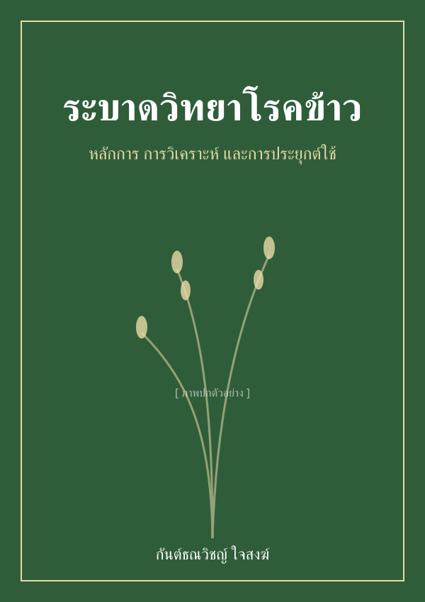

# Welcome {#sec-welcome .unnumbered}

::: {.content-visible when-format="html"}
{width="260" fig-align="left" style="float:right; margin: 0 0 1rem 1.5rem; box-shadow: 0 4px 14px rgba(0,0,0,.25);" fig-alt="Placeholder book cover"}
:::

ยินดีต้อนรับสู่ฉบับออนไลน์ของ **Exercise in Plant Disease Epidemiology** [ข้อความต้อนรับ ผู้เขียนจะเขียนใหม่]

## เล่มนี้เหมาะกับใคร {.unnumbered}

[ผู้อ่านเป้าหมาย]

## วิธีใช้เล่มนี้ {.unnumbered}

[วิธีใช้แบบฝึกหัดและเฉลย]

## สัญญาอนุญาต {.unnumbered}

[ระบุภายหลัง]

::: {.content-visible when-format="html"}

:::
